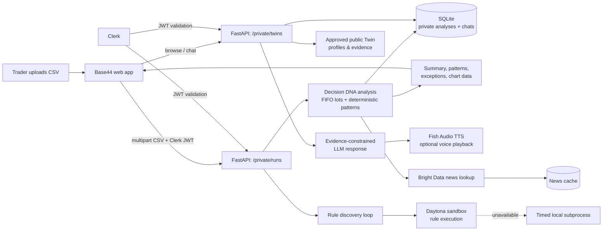

# Twin

**Twin** turns historical trade activity into an evidence-backed Decision DNA report, then lets a signed-in user compare that private report with approved public AI Twin playbooks. It is a hackathon prototype for explanation and reflection—not brokerage execution, a prediction engine, or financial advice.

> Historical observations are not predictions. Public Twins are AI-generated personas built from approved, attributable playbook data; they do not claim to be the real person.

## What it does

- Analyzes a CSV ledger with `date,symbol,side,qty,price` using deterministic FIFO lot matching.
- Computes realized P&L, return, holding period, win rate, average winners/losers, exceptions, and charts.
- Finds explainable patterns only when the sample supports them: holding duration, preferred symbols, position sizing, profitable exits, and loss-cutting limitations.
- Runs model-proposed rule code outside the API process in a Daytona sandbox, with a timed local fallback.
- Adds historical news context through Bright Data, with caching, validation, and bounded retry behavior.
- Provides six fictional public demo Twins with evidence-limited chat and optional Fish Audio speech.
- Lets signed-in users save a separate conversation with each Twin and optionally compare against their latest private analysis.

## Architecture



### Request flow

1. A user signs in with **Clerk** and uploads a trade CSV from the **Base44** app.
2. FastAPI validates and sorts the ledger, matches sells to earlier buys FIFO per symbol, and stores the finished private report for that user.
3. Base44 renders the summary, charts, patterns, and exceptions from computed result data.
4. In a saved Twin conversation, the user may opt in to share their *derived analysis summary* with that Twin. Raw CSV rows are not sent to the public Twin persona.
5. The Twin response must cite its approved public evidence and describe only supported comparison metrics. It cannot invent intent, future trades, or a buy/sell recommendation.

## Sponsor technologies

| Sponsor / technology | How Twin uses it |
| --- | --- |
| **Base44** | Builds the product UI: dashboard, charts, Twin discovery/profile pages, upload flow, Clerk-aware signed-in state, saved conversations, and private-comparison controls. It calls the FastAPI API through a public tunnel during local development. |
| **Cognition / Devin** | Devin implemented most of the rule-engine work in parallel cloud sessions: sample-data generation, features, rule scoring, API paths, Daytona wiring, insights, guru endpoints, exception labeling, and news retry work. Humans set the design, reviewed every diff, ran tests, caught a bad branch before it could remove the repository, and handled work requiring project credentials and final integration. |
| **Daytona** | Generated rule Python is never executed in the FastAPI request process. `sandbox.py` uploads feature data and a runner to a Daytona sandbox; if Daytona cannot be created or reached, the engine falls back to a timeout-bounded local subprocess so an analysis does not fail solely because the sandbox is unavailable. |
| **Clerk** | Provides sign-in and a user identity boundary. Base44 obtains a session JWT; FastAPI validates it against Clerk’s issuer/JWKS and scopes portfolios and saved conversations to that user. The browser never sends a Clerk secret key. |
| **Fish Audio** | Produces optional speech for server-generated Twin responses. The API only speaks a previously generated answer ID, rather than arbitrary client-supplied text; per-Twin authorized synthetic voice reference IDs can be configured. |
| **Bright Data** | Fetches historical news-search results for ticker/date context. Results are cached, ticker/date-filtered, and retried only for retryable empty, malformed, rate-limit, or server-error responses. Missing credentials or news do not fabricate market explanations. |

### Hackathon submission notes

**Devin (Cognition), two sentences:** Devin wrote most of the engine in parallel cloud sessions: the sample-data generator, feature builder, rule-scoring loop, API, Daytona sandbox, wiring, insights, the guru endpoints, exception labeling, and the news retry fix. A human read every diff and ran the tests before merging, and we caught and closed one branch that would have deleted most of the repo.

**Devin pitch:** *“Devin built most of the engine in parallel sessions, and we reviewed every pull request.”*

**If asked what humans did:** *“We set the design, reviewed every diff, caught the bad branch, and fixed what needed our API keys.”*

**If asked what Devin did not do:** *“Anything that needed our keys, the Bright Data news fix and the backend merge, went through Claude Code.”*

**Daytona, two sentences:** The model writes the rules as Python code, so that code never runs inside our API process. It runs in a Daytona sandbox, and if Daytona isn’t reachable, it falls back to a local subprocess with a timeout, so a run never fails because of the sandbox.

## Decision DNA analysis

### Accepted CSV

```csv
date,symbol,side,qty,price
2025-01-02,AAPL,BUY,10,190.00
2025-01-05,AAPL,SELL,5,202.00
```

The private analysis validates valid dates, `BUY`/`SELL`, and positive quantities and prices. Rows are sorted chronologically before matching.

### FIFO and outcome rules

- Sells are matched against earlier buy lots **FIFO per symbol**.
- Partial exits consume only the sold quantity from a lot; the remaining lot stays open.
- An unmatched sell is not assigned invented cost basis or P&L. It is flagged as an exception and warning.
- A completed matched lot records realized P&L, percentage return, and holding days.
- Patterns require enough evidence. Where there is insufficient data, the result returns an explicit limitation instead of an invented insight.

### Privacy model

| Data | Who can use it |
| --- | --- |
| Uploaded CSV and transaction rows | Private analysis service only |
| Derived report: summary, patterns, exceptions, warnings | Signed-in owner; may be used only when they enable private comparison |
| Public Twin profile/playbook/evidence | Anyone browsing public Twins |
| Public creator Twin | Only created from derived analysis with explicit publication consent; raw rows stay private |

## API layout

The root service has two groups of routes.

| Group | Purpose | Examples |
| --- | --- | --- |
| Root engine routes | Rule discovery, gurus, activation, and historical news | `POST /runs`, `GET /gurus`, `POST /activate`, `GET /news`, `GET /health` |
| Private Twin routes | CSV Decision DNA, public Twin profiles/chat, voice, portfolios, and conversations | `POST /private/runs`, `GET /private/twins`, `POST /private/twins/{id}/chat`, `GET /private/me/portfolios/latest` |

Important private endpoints:

```text
GET  /private/health
POST /private/runs
GET  /private/runs/{run_id}

GET  /private/twins
GET  /private/twins/{twin_id}
POST /private/twins/{twin_id}/chat
POST /private/twins/{twin_id}/speak

GET  /private/me/portfolios/latest
POST /private/me/conversations
GET  /private/me/conversations
GET  /private/me/conversations/{conversation_id}
POST /private/me/conversations/{conversation_id}/messages
POST /private/me/creator-twin
```

See [INTEGRATION.md](INTEGRATION.md) for request and response shapes, auth modes, and curl examples.

## Local setup

### 1. Install

```bash
git clone https://github.com/wwpatel/twin-engine.git
cd twin-engine
python3 -m venv .venv
source .venv/bin/activate
pip install -r requirements.txt
cp .env.example .env
```

### 2. Configure `.env`

At minimum, configure the services you plan to demonstrate:

```env
# Public/private API behavior
AUTH_MODE=clerk
CLERK_JWT_ISSUER=https://YOUR_INSTANCE.clerk.accounts.dev
CLERK_JWKS_URL=https://YOUR_INSTANCE.clerk.accounts.dev/.well-known/jwks.json
DATABASE_PATH=/absolute/path/to/twin.sqlite3

# Rule engine and Twin chat
ANTHROPIC_API_KEY=
ANTHROPIC_MODEL=claude-sonnet-5-5

# Optional integrations
BRIGHTDATA_API_KEY=
BRIGHTDATA_ZONE=
DAYTONA_API_KEY=
DAYTONA_API_URL=
FISH_AUDIO_API_KEY=
FISH_AUDIO_MODEL=s2.1-pro

PORT=8000
```

For local synthetic-data testing only, `AUTH_MODE=development` accepts `X-Dev-User-Id`. Do not use development mode for a deployed application.

### 3. Run

```bash
uvicorn main:app --reload --port 8000 --env-file .env
```

Sanity-check the mounted private service:

```bash
curl http://127.0.0.1:8000/health
curl http://127.0.0.1:8000/private/health
curl http://127.0.0.1:8000/private/twins
```

### 4. Base44 during local development

Expose the root service, not the legacy standalone backend:

```bash
cloudflared tunnel --url http://127.0.0.1:8000
```

Configure Base44 with the generated public URL and call `/private/twins`, `/private/runs`, and `/private/me/...` for the Decision DNA/Twin UI.

## Testing

Run the full repository suite:

```bash
pytest -q
```

Run the private-Twin suite directly:

```bash
pytest -q private_twins/backend/tests
```

The private suite covers FIFO matching, partial exits, unmatched sells, insufficient-data behavior, Twin chat guardrails, Fish Audio configuration, conversation persistence, and portfolio privacy boundaries.

## Safety and limitations

- This project is for historical analysis and education, not financial advice.
- Twin chat uses approved evidence and makes no claims about a real person’s current thinking or future actions.
- Market-condition claims are withheld unless data supports them; missing news stays a limitation, not a made-up explanation.
- Unmatched sell quantities are excluded from realized P&L.
- Local SQLite storage and in-memory answer/run stores are intentional hackathon-MVP choices, not production persistence.

## Repository structure

```text
.
├── main.py                         # Root rule-engine API
├── engine.py / features.py          # Rule discovery and features
├── sandbox.py                       # Daytona + local rule runner
├── news.py                          # Bright Data lookup and cache
├── private_mount.py                 # Mounts private Twins at /private
├── private_twins/backend/           # Decision DNA + Twin service
│   └── app/
│       ├── services/                # FIFO analysis, auth, chat, storage, Fish Audio
│       └── routes/                  # runs, twins, me, health
├── data/                            # Sample trades, cached news, precomputed gurus
└── tests/                           # Root engine tests
```
